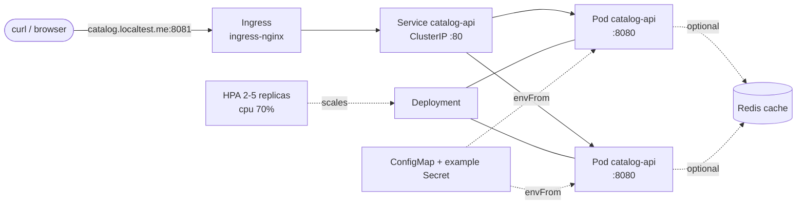

# dotnet-aci-k8s-lab

ASP.NET Core 8 Catalog API packaged as a container and deployed to a local Kubernetes cluster (kind), with CI that builds the image and validates the manifests.

> **Disclaimer — this is a hands-on lab, not production ownership.**
> It demonstrates practical working knowledge of Docker and Kubernetes on a local cluster. It is **not** evidence of owning or operating production AKS/ACI platforms (multi-node pools, networking/CNI design, RBAC/AAD integration, cost management, on-call, upgrades, etc.). Production concerns that are intentionally out of scope are listed under [Out of scope](#out-of-scope).

## Architecture



**API endpoints**

| Path | Purpose |
|---|---|
| `GET /health` | Liveness — process is up, no dependency checks |
| `GET /ready` | Readiness — cache (memory or Redis) read/write succeeds |
| `GET /api/products?category=&maxPrice=&page=&pageSize=` | Filtered, paged catalog |
| `GET /api/products/{id}` | Single product (404 if missing) |
| `GET /api/summary` | Inventory/category aggregates |
| `GET /api/info` | Serving host (pod name), environment, cache type |

The catalog is a read-only seed list cached in `IDistributedCache` (in-memory by default; Redis when `ConnectionStrings__Redis` is set). If the cache fails, requests fall back to the seed data instead of erroring.

## Repository layout

```
src/CatalogApi/            ASP.NET Core 8 minimal API (+ Services, Models, Health)
tests/CatalogApi.Tests/    xUnit: CatalogService unit tests + endpoint smoke tests
Dockerfile                 multi-stage: build -> (test) -> runtime (non-root)
docker-compose.yml         API only
docker-compose.redis.yml   override: adds Redis cache
k8s/                       Namespace, ConfigMap, example Secret, Deployment, Service, HPA, Ingress, kustomization
k8s/optional/redis.yaml    lab-only Redis
scripts/                   kind-deploy.sh / kind-deploy.ps1 / kind-config.yaml / minikube-notes.md
.github/workflows/ci.yml   tests, image build + container smoke test, kubeconform
```

## Run locally

### Docker Compose

```bash
docker compose up --build                                                  # API only
docker compose -f docker-compose.yml -f docker-compose.redis.yml up --build # API + Redis

curl http://localhost:8080/ready
curl "http://localhost:8080/api/products?category=displays"
curl http://localhost:8080/api/info          # cache: "memory" or "redis"
```

### Without Docker

```bash
dotnet test tests/CatalogApi.Tests
dotnet run --project src/CatalogApi        # prints the listening URL
```

### Kubernetes (kind)

Prereqs: Docker, [kind](https://kind.sigs.k8s.io/), kubectl.

```bash
./scripts/kind-deploy.sh            # bash
./scripts/kind-deploy.ps1           # PowerShell
```

The script creates the cluster, builds and loads `catalog-api:local`, installs ingress-nginx and metrics-server (with `--kubelet-insecure-tls`, lab only), applies `k8s/`, waits for rollout and smoke-tests `/ready`.

Manual equivalent:

```bash
kind create cluster --config scripts/kind-config.yaml
docker build -t catalog-api:local .
kind load docker-image catalog-api:local --name catalog-lab
kubectl apply -k k8s
kubectl -n catalog-lab rollout status deployment/catalog-api
kubectl -n catalog-lab port-forward svc/catalog-api 8080:80   # if not using ingress
```

Useful checks: `kubectl -n catalog-lab get deploy,pods,svc,hpa,ingress`, `kubectl -n catalog-lab describe hpa catalog-api`, repeat `curl .../api/info` to see requests spread across pods. Cleanup: `./scripts/kind-deploy.sh --delete` (or `-Delete`). minikube equivalent: [scripts/minikube-notes.md](scripts/minikube-notes.md).

Optional Redis in-cluster: `kubectl apply -f k8s/optional/redis.yaml`, uncomment `ConnectionStrings__Redis` in `k8s/configmap.yaml`, re-apply, then `kubectl -n catalog-lab rollout restart deployment/catalog-api`.

## Design choices worth noting

- **Image:** multi-stage; restore is a separate cached layer; runtime is `aspnet:8.0` running as the built-in non-root `app` user; `--target test` runs the unit tests in Docker.
- **Pod hardening:** `runAsNonRoot`, `readOnlyRootFilesystem` (+ `emptyDir` `/tmp`), all capabilities dropped, `RuntimeDefault` seccomp, namespace labelled for Pod Security `restricted`.
- **Probes:** startup + readiness (`/ready`) + liveness (`/health`); liveness deliberately has no dependency checks so a cache outage causes un-readiness, not restarts.
- **Rollouts:** `maxUnavailable: 0` rolling update; resource requests/limits set (HPA utilisation is relative to the CPU request).
- **Secrets:** `k8s/secret.example.yaml` holds a dummy value only to show `envFrom` wiring; no real secrets exist in this repo.

## What was verified

Honest status — please read:

| Item | Status |
|---|---|
| API, tests, Dockerfile, compose, K8s manifests, scripts, workflow written | Done |
| Local `dotnet build/test`, `docker build`, `kind` deployment | **Not executed by the author of this PR** — the authoring machine had no .NET SDK, Docker or gh CLI installed |
| Same checks in CI (`dotnet test`, image build + container smoke test on `/ready` `/health`, kubeconform on kustomize output) | Defined in `.github/workflows/ci.yml`; see the PR checks for results |

Run the Compose and kind steps above on a machine with Docker to confirm end-to-end; fix anything CI or a local run surfaces before relying on this.

## Out of scope

Production AKS/ACI provisioning (Terraform/Bicep), image registry push (ACR) and signing, image vulnerability scanning policy, network policies, TLS/cert-manager, Key Vault integration / workload identity, persistent state (the API has no database), observability stack, multi-environment overlays, GitOps.

## Mapping to Deloitte Senior Cloud Software Engineer (Job 48802)

| JD theme | Where this repo shows it | Level of evidence |
|---|---|---|
| Containers (Docker) | Multi-stage `Dockerfile`, non-root runtime, `.dockerignore`, Compose with Redis override | Practical, hands-on |
| Kubernetes | Deployment, Service, ConfigMap, Secret, HPA, Ingress, probes, security context, kustomize, kind scripts | Practical lab experience on local kind; **not** production AKS ownership |
| .NET / C# backend | ASP.NET Core 8 minimal API, DI, health checks, distributed cache with graceful degradation | Practical |
| CI/CD | GitHub Actions: tests, build-only image with smoke test, manifest validation (no secrets) | Practical |
| Testing | xUnit service tests (filtering, paging, aggregation, cache-failure fallback) + endpoint tests | Practical |
| Azure (ACI/AKS) | Image and manifests are portable to AKS/ACI, but no Azure deployment is included here | Conceptual only |
